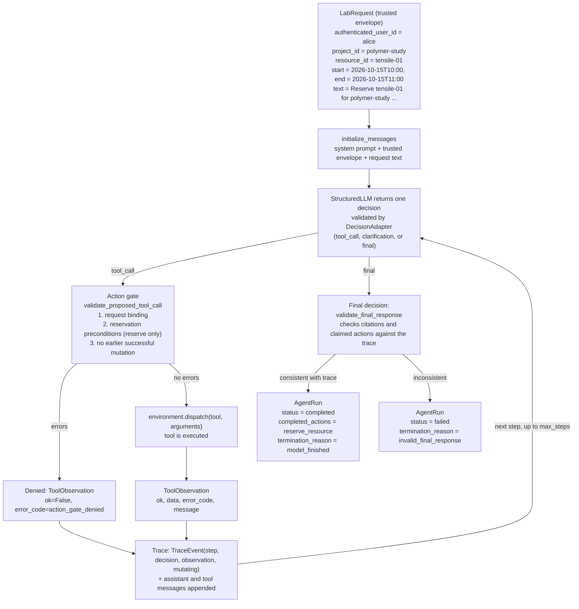

Data Flow Diagram: success_tensile scenario

This run has the model to make 4 tool calls, with each one passing the action gate. First, it searches policy using search_lab_documents to find TRN-210#tensile-tester. Then it checks for authorizations of action by alice. Next, it checks the status of tensile-01 for the specified interval. Finally, it calls reserve_resource. All of the preconditions are true, so a reservation is created. The final decision has status completed. It cites TRN-210#tensile-tester, and lists reserve_resource as the completed action. The function validate_final_response finds the citation in a successful search result, and the action in a successful mutating trace event. So the run ends as completed.
